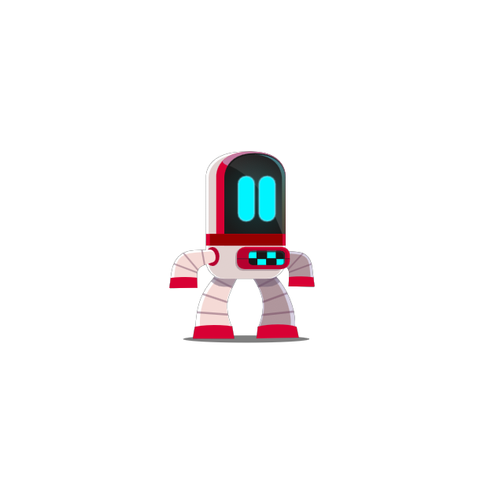

# MatchCanvasResolution fails when the renderer enables first

With `MatchCanvasResolution = true`, enabling `RiveCanvasRenderer` before
`RivePanel` leaves the render target at its logical size, making the artwork blurry.

**Setup:** 240×240 panel, canvas scale 2.5625, 615×615 display. Both captures use
Rive's public `examples/basic/Assets/cute_robot.riv`, frozen at the same frame.
The before image uses normal bilinear upscaling; no blur filter is added.

| Before: 240×240 render target | After: 615×615 render target |
| --- | --- |
|  |  |

## Reproduce

1. Open `examples/basic` in Unity with graphics enabled.
2. Copy [CanvasResolutionVisualTests.cs](CanvasResolutionVisualTests.cs) into
   `tests/package/PlayModeTests/Components/`.
3. Run `Rive.Tests.CanvasResolutionVisualTests` in the Test Runner's PlayMode tab.

The test forces renderer-first activation. Unpatched: saves `before.png` and fails
with expected 615, actual 240. Patched: saves `after.png` and passes. Output:
`Path.GetTempPath()/rive-canvas-resolution` (resolved path logged). Remove the
copied test afterward. Avoid batch/headless mode: capture needs the render pass.

## Cause and fix

`AttachCanvasProviders` returns when the panel's strategy is null. If the renderer
enables first, its sizing providers never attach. Call the panel's existing
`InitializeDefaultRenderTargetStrategyIfNeeded()` before reading the strategy;
make the helper `internal`. Custom/default strategy selection stays intact.

**Verified:** macOS/Metal, Unity 2022.3.62f2, Rive `0.5.3-canary.17` (`15f0c999`).
Unpatched visual test fails; patched visual test and all 16 canvas-renderer tests
pass. This proves the forced startup-order case; device behavior is unverified.
